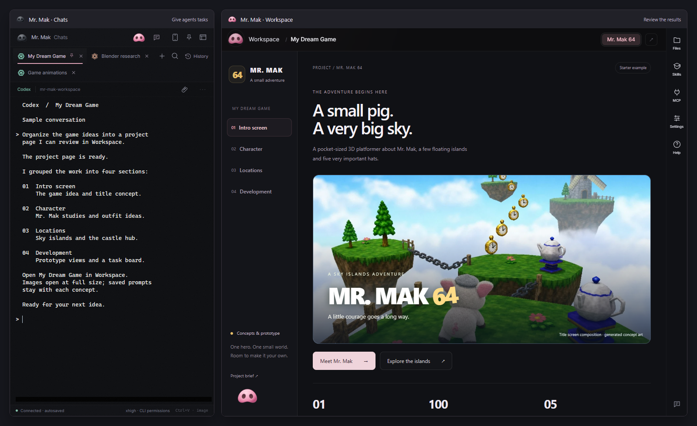
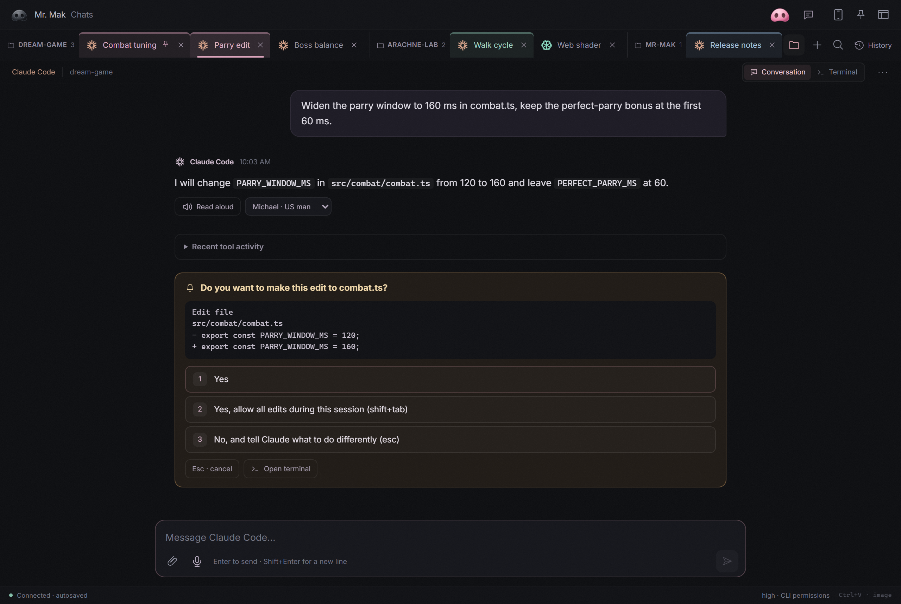
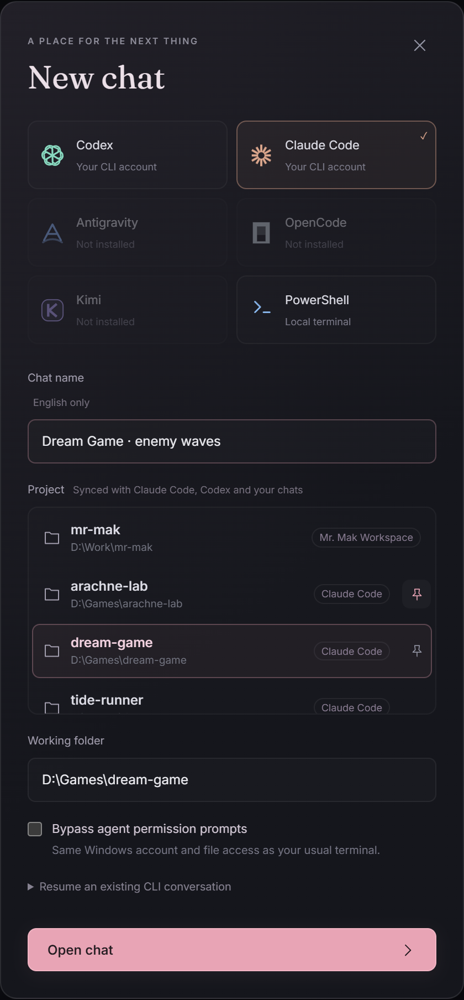
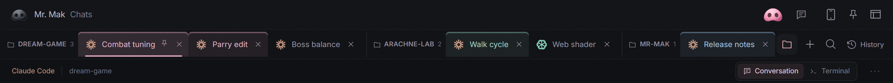

# Mr. Mak Workspace — Conversation view

This is a fork of **Mr. Mak Workspace**. This README lists only what the fork
adds. The original app, with its install steps, Workspace, skills and
documentation, is described and available at
**[github.com/witnesstodark/mr-mak-workspace](https://github.com/witnesstodark/mr-mak-workspace)**.
Read that README first for anything not covered here.

The additions turn the Chats window into a place where you can read and answer a
conversation instead of only watching a terminal. Every change is listed in the
[changelog](CHANGELOG.md#unreleased).



## Conversation view

### Read a chat as a conversation

Claude Code and Codex chats have a **Conversation | Terminal** switch. The
Conversation view reads the CLI's own transcript and shows it as messages, with
Markdown, images and recent tool activity. Its composer sends text, attachments
and dictation to the same terminal, and **Stop** (Esc) interrupts the agent.


A new chat opens in Terminal until it has a conversation, so folder-trust and
sign-in questions are never hidden. Links to local files in a reply open a
Workspace preview, resolved against the chat's folder.

### Answer permission menus with a click

When the CLI asks for permission, the numbered menu at the bottom of the
terminal appears as buttons in the conversation. Before sending any key, Mr. Mak
reads the screen again and checks that it is still the same prompt, so a late
click cannot answer a newer question.



### Autocomplete commands

Type `/` at the start of a message, or `$` before a word in a Codex chat, to
list that CLI's built-in commands plus the project, user and plugin commands and
skills. A command that opens a picker, such as `/model`, switches the chat to
Terminal after it is sent.

### Edit a sent message

In a Claude Code chat, the pencil on your message opens an editor, as with
Esc Esc in Claude Code. Sending rewinds the conversation to before that message
(files are not changed) and sends the edited text. After a rewind, including one
made in the terminal, the view shows only the current branch. Codex chats do not
support editing yet.

### CLI events and the active model

What the CLI adds to a chat, such as background agent results, slash commands
and their output, appears as compact events instead of raw tags. A review's
findings become a list with file links. Choose **Compact**, **Expanded** or
**Hidden** in the chat options. The status bar shows the model the chat last
used, next to reasoning effort and permissions.

### Subagents and background commands

For Claude Code chats, a line above the composer counts the subagents and
background terminal commands that are still working, including those that keep
going while the chat waits. Expand it to see each agent's task and current step
(for example `Bash · Run the tests`), each command and the agent that started
it, and how long each has been running. Codex chats do not show this yet.

## Workspace and Chat themes

Choose independent themes for Workspace and Chat in **Settings → Appearance**,
or use the Chat header's Appearance button. Thirteen named palettes include
**Codex / ChatGPT**, **Antigravity** and **Claude Code**, plus light and dark
variants of **Nordic**, **Forest**, **Sandstone**, **Ocean** and **Plum**.
Dark, Light and System remain available.

Workspace themes also style standard reports. Chat themes cover Conversation
and Terminal while retaining drafts and terminal connections. Choices save and
sync across open windows. See the [palette list](desktop/README.md#workspace-and-chat-themes).

## Projects and tabs

### Start in a recent project

**New chat** lists the folders you have worked in: the Workspace, projects
opened in Claude Code, folders where Codex ran and folders of earlier Mr. Mak
chats. Pin favorites to keep them at the top. History can filter by project, and
the voice coordinator can open a chat in a project you name. A paired phone may
only start a chat in a listed folder, never in an arbitrary path.



### Continue a long chat in a fresh one

After a set number of your messages (40 by default; chat options **⋯**), a chat
offers **Summarize and continue**. Mr. Mak asks the agent for a handoff, saves it
in `inbox/handoffs`, and opens "*name* · continued" in the same folder with the
same agent and settings. The new chat starts by reading that handoff. Choose
**Later** or **Not for this chat** to dismiss it.


### Group, collapse and rename tabs

The folder button next to **+** groups open chat tabs by project, and the tab
shortcuts follow the grouped order. Click a project label to collapse its tabs;
the open chat stays visible. Double-click a tab, or press F2, to rename its chat:
Enter saves and Escape cancels.



## Codex 0.163

Conversation views read Codex 0.163 chats. Codex's injected project instructions
and environment no longer appear as your messages, and tool activity includes
its custom tool calls. Command autocomplete matches 0.163 (`/approvals` is now
`/permissions`).

Chats stay linked to their conversation: Mr. Mak starts Codex with `--no-daemon`
when the installed version offers it, because Codex's shared background server
otherwise left chats that did not bypass permissions without a Conversation
view, model or turn notifications. A chat also follows a rewind made in its
terminal (Esc Esc) and a new thread started there with `/new`.

## Read aloud on the desktop

The desktop Conversation view can read the latest reply aloud with the same free
local voices as the phone, Michael (US) and Emma (UK). **Preparing audio…** shows
while your computer generates each part; the first one also waits about ten
seconds for the model to load.

Read aloud needs a one-time setup with Python 3.10–3.12:

```powershell
python scripts/setup-local-voice.py read-aloud
```

If your system Python is newer, [uv](https://docs.astral.sh/uv/) can run the
setup with a managed 3.12 without changing it:

```powershell
uv run --no-project --python 3.12 scripts/setup-local-voice.py read-aloud
```

## On the phone

These changes apply to the mobile web app. Pairing and the rest of phone access
are described in the original README and in
[mobile access and voice input](docs/mobile-access.md).

- **Wrap mode.** The Terminal view opens in Wrap: the live terminal text wraps to
  the screen and can be selected. Fit and Actual remain available.
- **Pull to refresh.** Pull down from the top of the Workspace to reload the
  report list. An open report reloads at the same page and section. The
  browser's own pull no longer reloads the whole app.
- **Back gesture.** It returns to the previous screen instead of leaving the app:
  a chat or the Workspace to the chat list, an open report to the Workspace list
  and History to the open chats. On the chat list it leaves the app as before.
  It uses the browser's close request (`CloseWatcher`), available in Chrome and
  Edge on Android.
- **Cleaner messages.** Messages sent from Mr. Mak no longer show Claude Code's
  `<pasted_content>` tags.
- **Background work.** The Conversation view shows the same subagents and
  background commands strip as the desktop.


## Update an installed source build

`Setup.ps1 -Mode Update` accepts an installation folder that Windows stores with
quotes in the registry. Run it from a PowerShell window opened outside Mr. Mak;
it builds, waits for you to choose **Quit** from the tray, installs into the same
folder and restarts:

```powershell
powershell -NoProfile -ExecutionPolicy Bypass -File .\Setup.ps1 -Mode Update
```

For installation, requirements and everything else, follow the
[original repository](https://github.com/witnesstodark/mr-mak-workspace).

## License

Application code and original workflow documentation are under the MIT license.
Bundled third-party skill materials keep their original licenses; see
[third-party notices](THIRD_PARTY_NOTICES.md).
