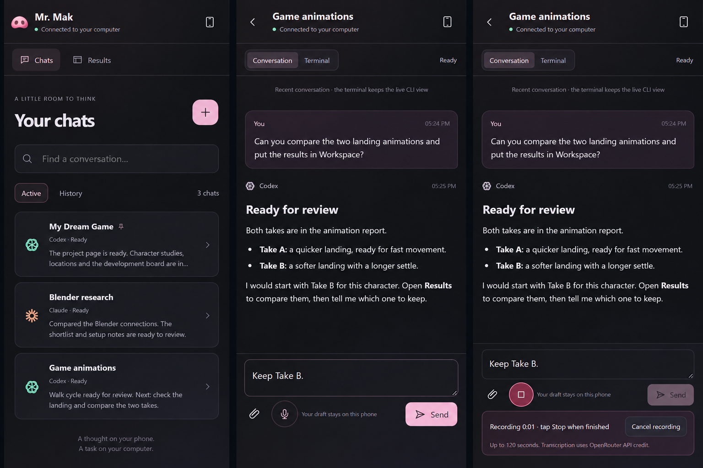
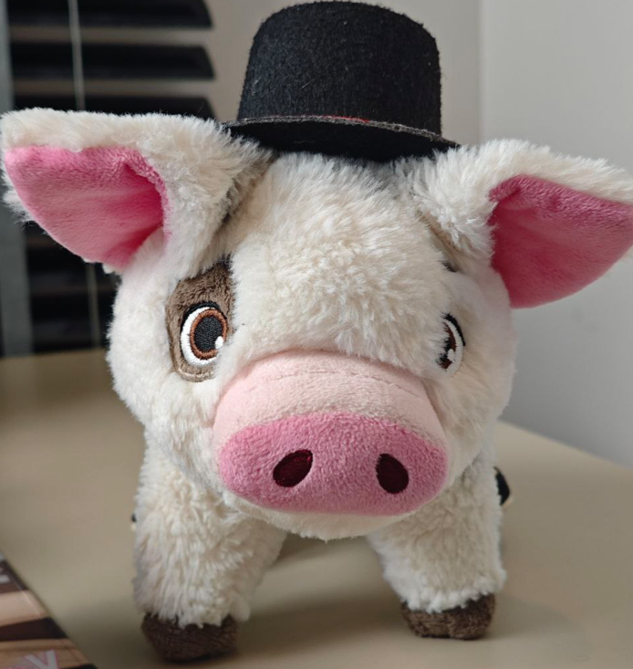

# Mr. Mak Workspace

Your CLI agents, a visual Workspace, and access from your phone.

Mr. Mak runs **Codex, Claude Code, Antigravity, OpenCode or Kimi** in real CLI
terminals and puts the results in a Workspace of project pages, reports and
media. It has two desktop windows: **Chats** for giving tasks, and **Workspace**
for reviewing what the agents made. A paired phone follows the same chats.

This version turns the chat window into a place where you can read and answer
a conversation instead of only watching a terminal. The changes are listed in
the [changelog](CHANGELOG.md#unreleased).


## What's new

### Read a chat as a conversation

Claude Code and Codex chats have a **Conversation | Terminal** switch. The
Conversation view reads the CLI's own transcript and shows it as messages,
with Markdown, images and recent tool activity. Its composer sends text,
attachments and dictation to the same terminal, and **Stop** (Esc) interrupts
the agent.


A new chat opens in Terminal until it has a conversation, so folder-trust and
sign-in questions are never hidden. Links to local files in a reply open a
Workspace preview, resolved against the chat's folder.

### Answer permission menus with a click

When the CLI asks for permission, the numbered menu at the bottom of the
terminal appears as buttons in the conversation. Before sending any key,
Mr. Mak reads the screen again and checks that it is still the same prompt, so
a late click cannot answer a newer question.


### Start in a recent project

**New chat** lists the folders you have worked in: the Workspace, projects
opened in Claude Code, folders where Codex ran and folders of earlier Mr. Mak
chats. Pin favorites to keep them at the top. History can filter by project,
and the voice coordinator can open a chat in a project you name. A paired
phone may only start a chat in a listed folder, never in an arbitrary path.


### Continue a long chat in a fresh one

After a set number of your messages (40 by default; chat options **⋯**), a chat
offers **Summarize and continue**. Mr. Mak asks the agent for a handoff, saves
it in `inbox/handoffs`, and opens "*name* · continued" in the same folder with
the same agent and settings. The new chat starts by reading that handoff.
Choose **Later** or **Not for this chat** to dismiss it.


### Group tabs by project

The folder button next to **+** groups open chat tabs by project. Tab shortcuts
follow the grouped order.


### Read aloud on the desktop

The desktop Conversation view can read the latest reply aloud with the same
free local voices as the phone, Michael (US) and Emma (UK). **Preparing audio…**
shows while your computer generates each part; the first one also waits about
ten seconds for the model to load.

Read aloud needs a one-time setup with Python 3.10–3.12:

```powershell
python scripts/setup-local-voice.py read-aloud
```

If your system Python is newer, [uv](https://docs.astral.sh/uv/) can run the
setup with a managed 3.12 without changing it:

```powershell
uv run --no-project --python 3.12 scripts/setup-local-voice.py read-aloud
```

### On the phone

The phone's Terminal view opens in **Wrap** mode: the live terminal text wraps
to the screen and can be selected. Fit and Actual remain available. Messages
sent from Mr. Mak no longer show Claude Code's `<pasted_content>` tags.


## On your phone

Read replies, send follow-ups or images, and open Workspace reports from a
mobile web app you can add to your Home Screen. The phone connects to Mr. Mak
on your computer through **Tailscale**; the agents keep running on the computer
with their existing CLI accounts.

<a href="docs/assets/mobile-overview.png"></a>

Pair from the phone button in Chats, scan the QR code and confirm the matching
code on the desktop. See [mobile access and voice input](docs/mobile-access.md).

## Before you start

Install and sign in to at least one agent CLI. They are separate installations,
not bundled with Mr. Mak:
[Codex CLI](https://developers.openai.com/codex/cli),
[Claude Code](https://code.claude.com/docs/en/setup),
[OpenCode](https://opencode.ai/docs/),
[Antigravity](https://www.antigravity.google/docs/cli/install/) or
[Kimi Code](https://moonshotai.github.io/kimi-cli/).

**No API key is needed** for Claude Code or Codex chats when you sign in with an
eligible subscription; Mr. Mak runs the real CLI with its existing login and
normal plan limits apply. The optional voice coordinator needs Codex CLI and
your own OpenAI API key, billed separately.

## Install and update

On Windows, install **Mr. Mak Workspace** from the
[Releases](https://github.com/witnesstodark/mr-mak-workspace/releases/latest)
installer, then open **Start Mr. Mak.cmd** in your cloned repository. Use **+**
in Chats to open an installed CLI.

To build from source, install Node.js 22.20+ and the Tauri prerequisites (Rust
and the Visual Studio C++ build tools on Windows), then run:

```powershell
powershell -ExecutionPolicy Bypass -File .\Setup.ps1 -Mode Check
powershell -ExecutionPolicy Bypass -File .\Setup.ps1 -Mode Desktop
```

To update an installed source build, run this **from a PowerShell window opened
outside Mr. Mak**. It builds, waits for you to choose **Quit** from the tray,
installs into the same folder and restarts:

```powershell
powershell -NoProfile -ExecutionPolicy Bypass -File .\Setup.ps1 -Mode Update
```

Linux and macOS builds are covered in [getting started](docs/getting-started.md)
and the [macOS notes](docs/macos.md). See the [update guide](docs/updating.md)
for updating the app without replacing your projects, and the
[architecture](desktop/README.md) for the source layout.

## What is inside

| Example | What it demonstrates |
| --- | --- |
| **My Dream Game** | Mr. Mak 64: an illustrated game hub with an intro screen, character studies, locations and a development board. |
| **Creative MCP Connections** | A researched connection shortlist, source links and a practical setup checklist. |
| **Make Workspace Yours** | Getting started, everyday use and changes you can ask an agent to make. |
| **Arachne Character Lab** | Versions 1 through 9, expandable saved prompts, 158 images and eight motion studies. |

Twenty project skills cover planning, handoffs, Workspace reports, image and
motion references, generation providers, Blender game animation, and game VFX,
UI, audio and level design. Read the [skill index](docs/skills.md). The
maintained instructions live in `.agents/skills`; run `npm run skills:sync`
after editing them.

## Make it yours

Edit the placeholder files in `context/`, keep reusable lessons in `knowledge/`,
and save workflows in `processes/`. English is the default for stored content.
The Win-key shortcut and permission bypass both start disabled. See
[customization](docs/customization.md) and [sharing your version](docs/sharing.md).

Application code and original workflow documentation are under the MIT license.
Bundled third-party skill materials keep their original licenses; see
[third-party notices](THIRD_PARTY_NOTICES.md).

---

Mr. Mak is small.


