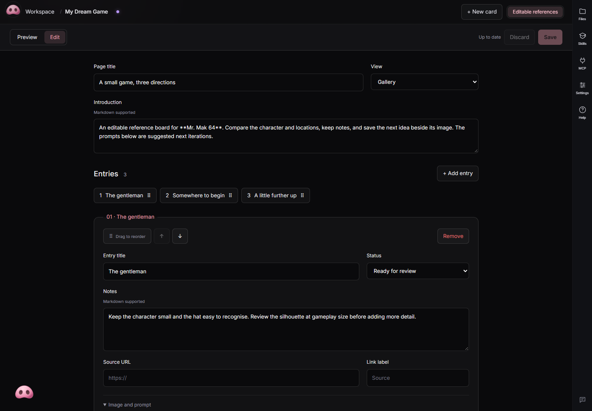
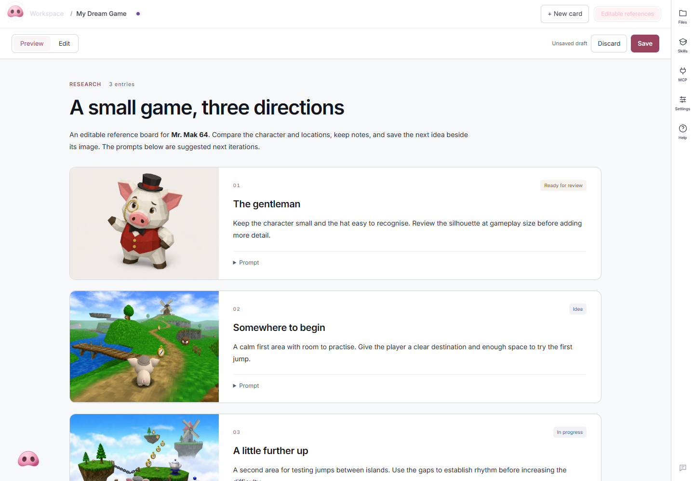

# Editable Workspace cards

Use **+ New card** in the desktop Workspace to make a Gallery or Research card.
Both views use the same content format. You can change the view without losing
the entries, images or prompts.

## Working with a card



Choose **Edit** to change the page title, introduction and entries. Notes support
Markdown. Each entry can have an image, a saved prompt, a source link and a status.
Use the order chips to drag entries into place, or use their up/down buttons.
Removing an entry offers **Undo remove** until you save. Removing an image only
removes its reference; it does not delete the file from disk.

**Preview** shows the draft as it will appear. **Save**, or Ctrl/Cmd+S, writes it
to disk. Uploaded images are copied into the card's `media/` folder. An upload
becomes part of the page after you save. Cancelling a draft keeps any uploaded
files so another reference is never deleted accidentally.

Drafts survive switching cards and reloading the same app window when browser
session storage is available. Save before closing the app; a draft is not a
replacement for a saved file.

If an agent or another window edits the file while your draft is open, Mr. Mak
keeps your draft and stops the save. **Review latest version** shows the disk
version. You can download your draft before choosing **Discard my draft and
load latest**, then reapply the changes you want. There is no silent force-save.

Before replacing a saved card, the service keeps the previous contents under
`.mrmak/card-backups/`, with a receipt identifying the original file. These are
local recovery copies and are excluded from Git. Use Git for longer history.

## Where the content lives



```text
workspace/
  workspace.json
  2026-10-20_character-references-a1b2c3d4/
    content.card.json
    media/
      reference-a1b2c3d4.webp
```

The `.card.json` file is the source of truth. The application supplies the view;
there is no generated HTML copy to keep in sync. Prose inside `summary` and
`body` uses Markdown. Longer documents can still be separate `.md` tabs, opened
with the existing Markdown editor.

Cards remain regular project files. Agents can read and update them with their
usual file tools. No database, cloud account, extra model call or plugin is needed.
Existing custom HTML, Markdown and 3D comparison tabs remain supported.

Phone access and browser preview can **read** editable cards. Editing and image
import are available in the authenticated desktop Workspace. Images can be
opened at full size and downloaded from the preview.

## Agent authoring format

An editable step is registered explicitly:

```json
{ "name": "References", "path": "content.card.json", "viewer": "card" }
```

Keep the data inside the entity folder:

```json
{
  "format": "mrmak-card",
  "version": 1,
  "template": "gallery",
  "title": "Character references",
  "summary": "Compare the silhouette before choosing a direction.",
  "items": [
    {
      "id": "explorer",
      "title": "The explorer",
      "body": "Keep the **large hat**. Simplify the belt details.",
      "image": "media/explorer.webp",
      "alt": "Explorer character reference",
      "prompt": "Next iteration: simplify the belt and preserve the silhouette.",
      "url": "https://example.com/reference",
      "linkLabel": "Reference source",
      "status": "review"
    }
  ]
}
```

Required page fields: `format`, `version`, `template`, `title`, `items`.
Required entry fields: `id`, `title`. Other fields shown above are optional.

- Templates: `gallery`, `research`.
- Statuses: `idea`, `in-progress`, `review`, `done`; omit for no status.
- IDs: unique per page, 1–80 letters, numbers, hyphens or underscores, starting
  with a letter or number. Preserve them when editing or reordering entries.
- Images: PNG, JPEG, WebP or GIF. Paths are relative to the content file and
  stay inside its folder. Absolute paths, parent traversal, hidden folders and
  external image URLs are not accepted. Import an image into the card instead.
- Sources: complete HTTP(S) URLs without credentials embedded in the address.
- Limits: 200 entries and 1 MB per document; 16 MB per uploaded image.
  Titles allow 200 characters, introductions 20,000, and notes/prompts 40,000.
- Unknown versions and fields are rejected so an older editor cannot silently
  discard content it does not understand. Raw HTML in Markdown is not executed.

Before an agent changes a card, reread the current file. Preserve entries and
fields outside the requested edit, then validate it with the shared validator:

```sh
node --input-type=module -e "import { readFile } from 'node:fs/promises'; import { validateCard } from './desktop/service/card-schema.mjs'; validateCard(JSON.parse(await readFile(process.argv[1], 'utf8'))); console.log('Card valid');" workspace/example/content.card.json
```

Write the complete file atomically and update the entity's `updated` date in
`workspace/workspace.json`. If changing the title of a single-page card, update
its listing title too. The desktop editor does these registry updates for you.
Agents that write files directly are responsible for preserving concurrent
changes; the desktop revision checks cannot intercept an agent's filesystem write.

The same entity can keep custom HTML alongside editable cards. Start with one
new tab and check it before converting an existing report. Do not convert a
finished custom report merely because an editable template is available.
