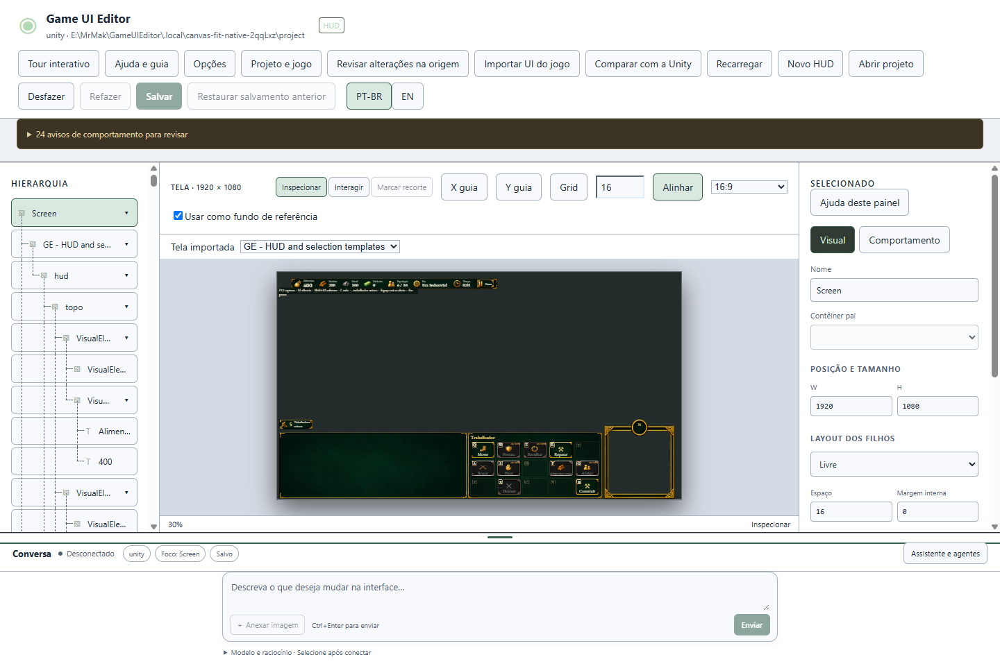
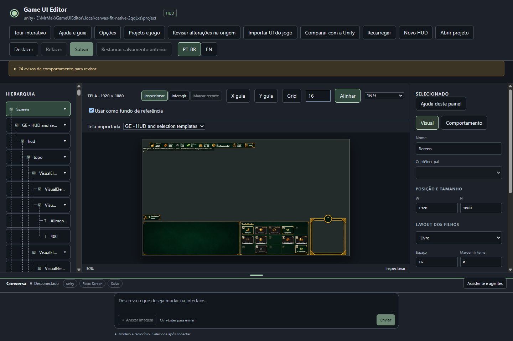

# Canvas inteiro e chat no rodapé — 0.3.3

**O canvas agora cabe inteiro no espaço disponível, sem rolagem até sua parte
inferior.** O chat alcança o rodapé da janela. O mesmo lançador abrirá a cópia de
teste **0.3.3**, preservando o projeto importado e o painel de comandos corrigido.

**Reteste aprovado pelo usuário:** “testado e funcionando”. A confirmação é geral
para os ajustes entregues na 0.3.3; não foram fornecidos resultados individuais
por passo. A aplicação/reimportação na Unity segue como próxima validação separada.

| Ajuste | Resultado |
| --- | --- |
| Enquadramento | Considera largura e altura livres; acompanha a janela, o chat, as barras de ferramentas e as dimensões do documento. |
| Espaço de trabalho | Removida a faixa redundante abaixo do chat. A indicação de escala fica fora da área medida do canvas; janelas estreitas usam uma barra de ferramentas com rolagem horizontal. |
| Projeto | Layout de visualização sem migração ou reimportação. A amostra preserva os mesmos bytes salvos e suas 15 células de comandos. |

O canvas passa a usar uma escala menor quando a janela ou a área livre diminui.
Você pode continuar arrastando o divisor do chat; o enquadramento acompanha esse
movimento. A hierarquia e o inspetor mantêm suas próprias áreas de rolagem.

A prova da amostra Windows cobriu **850 × 650, 1280 × 720, 1440 × 960 e
2560 × 1440**, nos dois temas e com chat mínimo/máximo: 16 combinações, sem
rolagem no canvas. Inspecionar/Interagir e os bytes do projeto foram conferidos.
As **30 verificações focadas de interface** também passaram: altura do documento,
arraste, guias, edição de texto, conversa, hierarquia e reimportação. A suíte core
completa e o ciclo de instalação não foram repetidos nesta correção de layout.

[Evidências e pacote](evidence-canvas-0.3.3.json) ·
[Roteiro do teste](test-0.3.0.md) ·
[Correção anterior da grade](commands-0.1.1.md)

Não houve modificação no jogo ou inferência real. A instalação antiga foi
preservada. O reteste destes ajustes foi aprovado; o aceite completo M4/M6 permanece aberto.
