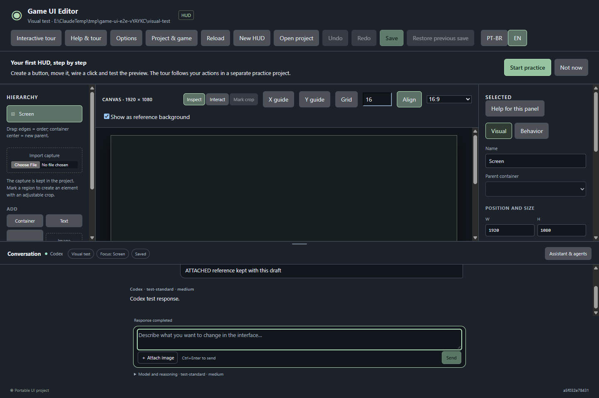
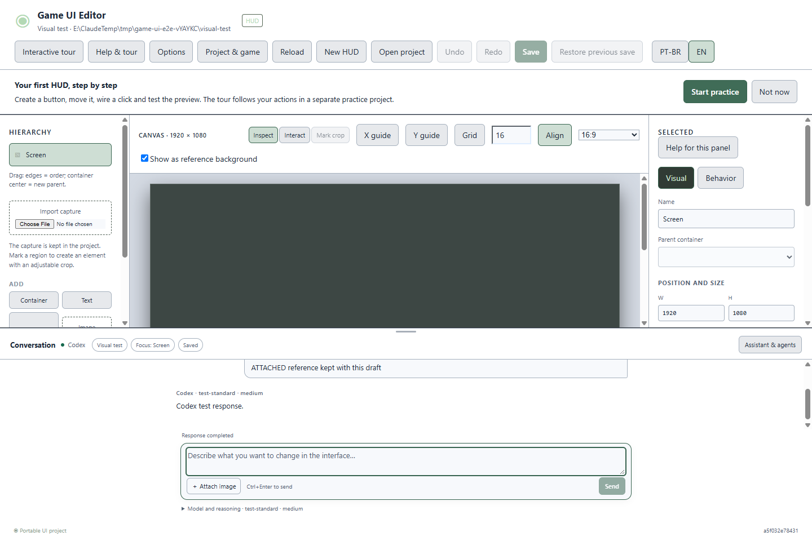

# Chat 0.2.2 — entrega do visual aprovado

O novo visual foi aplicado ao chat real e empacotado na **0.2.2**. A instalação atual **0.2.0** foi preservada. A [proposta aprovada](chat-proposal.html) continua disponível como referência ilustrativa.

## O que mudou

| Parte | Entrega |
| --- | --- |
| Espaço de trabalho | Dock inferior com divisor por arraste ou teclado (setas, Home/End), limitado pelo espaço de autoria. Canvas e conversa têm rolagens próprias. |
| Conversa | Mensagens com largura limitada, identificação do remetente/modelo e atividade real. Ler mensagens antigas e carregar páginas anteriores preserva a posição de leitura. |
| Compositor | Texto, anexos privados com prévia/remoção e Enviar/Continuar/Parar no mesmo bloco. Ctrl+Enter envia explicitamente. Recolher controles preserva texto e referências. |
| Controles | Fichas de projeto, seleção e rascunho no cabeçalho. Modelo/raciocínio recolhíveis; conexão, histórico/ajuda local, contexto e operações externas em painel próprio. |
| Propostas e orientação | Entrada de revisão na conversa e diálogo separado com conflitos e salvamento explícito. Ajuda atualizada em PT-BR/EN; temas claro, escuro e sistema preservados. |

## Verificado

- **112 testes de núcleo** e **74 casos únicos de interface**: 37 no navegador e 37 no Windows isolado. A execução ampla passou 73/74; o teste do tour Windows foi ajustado para aguardar a gravação assíncrona da preferência. O reteste específico passou nos dois ambientes. O código do produto não mudou após a execução ampla.
- Histórico, modelo/esforço, conexão sem envio, anexos, Continuar/Parar, revisão e conflitos, hierarquia/arraste, cursor de conteúdo, tour e idiomas.
- Novas provas de divisor por ponteiro/teclado, compositor alcançável, preservação de texto/anexos, rolagem independente e ancoragem/paginação do histórico.
- Instalador e quatro ZIPs preparados; **219 arquivos** e hashes dos pacotes verificados. O teste de instalação/atualização/desinstalação anterior não foi repetido nesta revisão.

Os testes de conversa usam peer determinístico, sem inferência real. Capturas abaixo mostram a aplicação Windows isolada, com dados de teste.

## Entrega e atenção

Pacote local: `E:/MrMak/GameUIEditor/.local/releases/game-ui-editor-0.2.2-20261020T140803525Z`.

Instalador: `Game UI Editor_0.2.2_x64-setup.exe`. Fontes editáveis, versão portátil, integração Unity e piloto GE foram preservados nos quatro arquivos ZIP.

Ainda é necessário atualizar a instalação quando for conveniente e conferir o uso físico do arraste e do novo chat. A altura do dock vale para a sessão aberta; não foi criado um novo arquivo de preferências. O primeiro login novo, a validação nativa isolada do GE e o aceite final de M4/M6 continuam separados. Os marcos permanecem **4/6**. Nenhuma aplicação ativa foi reiniciada.

Consulte o [registro de evidências e hashes](evidence-chat-0.2.2.json).
