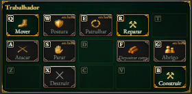
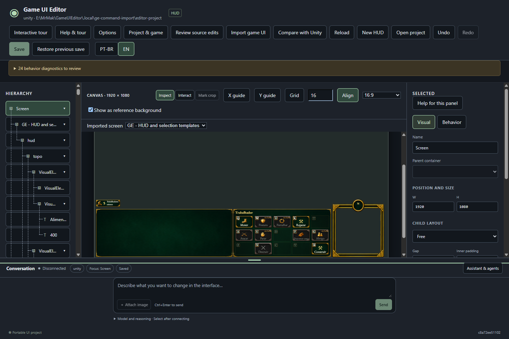

# Painel de comandos corrigido — exportador 0.1.1

**A amostra do teste já mostra a grade e seus comandos.** O editor permanece na
versão **0.3.2**; a correção está no exportador Unity **0.1.1** e nos dados
reimportados. O mesmo `Open-Test.cmd` abre a cópia corrigida.

| Resultado | Estado |
| --- | --- |
| Painel e células | Área medida de aproximadamente 643 × 317 px, três linhas e 15 posições; teclas QWERTASDFGZXCVB, espaços vazios, textos e artes originais. |
| Projeto de teste | 430 elementos e 28 recursos; os outros 290 elementos foram preservados. Backup e reimportação pelo responsável do projeto, sem conflitos pendentes. |
| Verificação | Prova Unity com painel oculto e visível; restauração após sucesso/falha; dez testes de importação/apresentação e editor Windows em três larguras e dois temas. |

O defeito era uma captura de **0 × 0 px**: os elementos existiam, mas não tinham
área visível. O exportador agora prepara uma vista temporária pelo renderizador
nativo. Quando o painel original está oculto, usa um exemplo declarado dos
comandos de trabalhador, sem selecionar unidades nem executar ações. Quando
está visível, mantém o conteúdo nativo atual. Uma captura sem medidas é recusada;
uma falha conserva a exportação válida anterior e restaura a interface original.

Use **Tela importada → GE - HUD and selection templates** e role o canvas até
a região inferior da HUD. A seleção/fila simuladas, as seis telas e a reabertura
foram conferidas. Na simulação, cancelar uma fila ainda reduz três itens para dois.

**Limite mantido:** a grade é uma amostra visual estática. Troca dinâmica por
seleção, custos, disponibilidade e ações reais dos comandos continuam fora desta
correção. O exemplo permanece o mesmo ao alternar os cenários de seleção.

[Pacote Unity corrigido — 0.1.1](files/unity-import-0.1.1.zip) ·
[Provas da correção](evidence-commands-0.1.1.json) ·
[Roteiro do teste](test-0.3.0.md)

O executável e o instalador 0.3.2 não foram recompilados; os pacotes anteriores
continuam históricos. Não houve inferência real, comando enviado pela prévia ou
mudança em código do GE. Reteste humano e aceite M4/M6 permanecem abertos.
