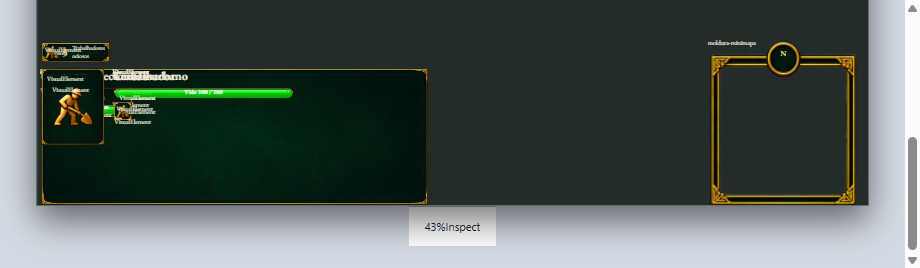
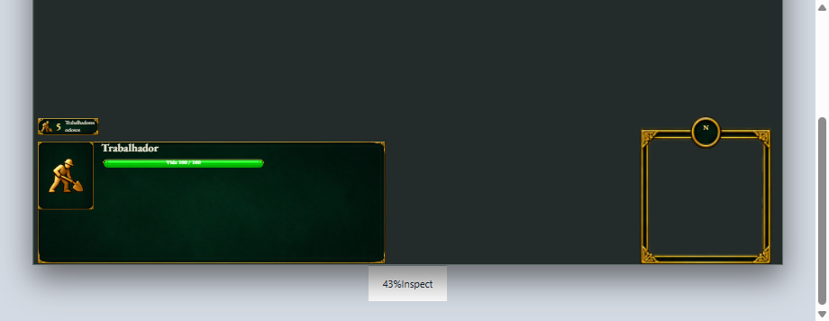
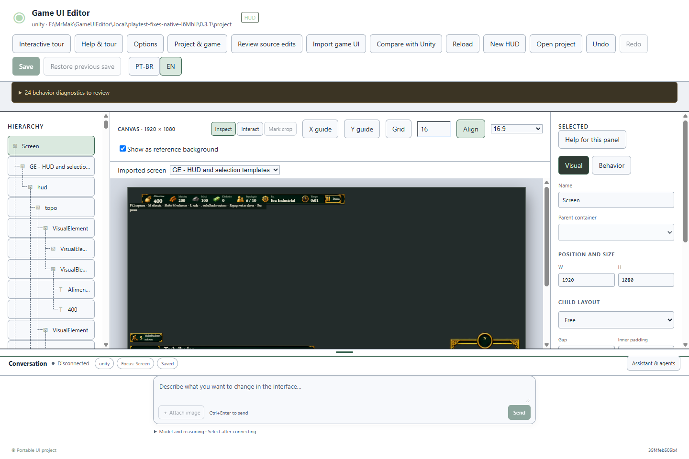
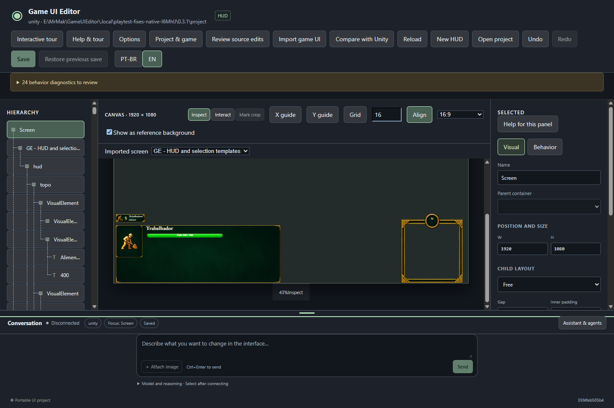

# Ajustes do teste — 0.3.1

**Os dois relatos foram corrigidos e verificados. Reteste humano pendente.** A cópia portátil de teste usa a 0.3.1 e abre os mesmos projetos; a instalação 0.2.0 permanece preservada.

| Relato | Ajuste | Prova |
| --- | --- | --- |
| PT-2026-10-20-01 — chat ocupa espaço excessivo no mínimo | O mínimo acompanha os controles reais; o histórico fica recolhido nesse limite e retorna ao ampliar. Anexos, avisos e campos de modelo continuam alcançáveis. | Na mesma janela Windows, mínimo de **280 → 192 px**. A medida varia com idioma, largura e controles abertos. |
| PT-2026-10-20-02 — nomes internos confundem o texto da UI | O canvas exibe o conteúdo autorado, sem usar o nome como substituto de texto vazio. A tela importada também respeita as condições de visibilidade existentes, evitando sobrepor variantes ocultas. Nomes e elementos ocultos continuam na hierarquia. | **179 rótulos indevidos → zero** na amostra. “Trabalhador” aparece legível; os textos visíveis correspondem ao projeto e o arquivo salvo permaneceu idêntico. |

## Conferir agora

Use o mesmo `Open-Test.cmd` na pasta `E:\MrMak\GameUIEditor\.local\manual-test-0.3.0-MndmD0`. O nome da pasta registra a preparação inicial; o lançador agora aponta para `application-0.3.1-final`. A aplicação portátil anterior foi preservada.

1. Arraste o divisor da conversa para baixo até o mínimo, ou foque o divisor e pressione **Home**. Amplie novamente para ver o histórico. Confira que digitação e envio continuam alcançáveis.
2. Na HUD importada, use **Interagir / Interact**, escolha o cenário de uma unidade e volte a **Inspecionar / Inspect**. Confira o título e a arte da seleção. Alterne as outras telas normalmente.
3. Continue editando os mesmos projetos. A correção não exige reimportar, recriar a HUD ou migrar o documento. Durante o reteste, novos relatos serão registrados antes de qualquer implementação adicional.

## Antes e depois — Windows

Mesmo projeto salvo, janela e cenário de unidade; viewport rolado até a seleção. O aumento da área disponível vem da redução do chat.

## Verificação e entrega

- **123 testes core**, zero falhas.
- **18 execuções focadas de interface**: nove casos no navegador e nove no Windows, cobrindo divisor, compositor/anexos, histórico, edição de texto, hierarquia e importação/reimportação. Não é uma repetição da suíte completa de 78 execuções da 0.3.0.
- Comparação nativa do editor Windows: projeto preservado byte a byte, textos visíveis corretos, ausência dos nomes indevidos e fila simulada de três para dois itens. As imagens acima foram inspecionadas.
- Instalador 0.3.1 e quatro ZIPs preparados localmente: Windows portátil, fontes editáveis, integração Unity e piloto GE. **262 arquivos** e os hashes dos quatro arquivos ZIP e do instalador conferidos; fontes empacotadas correspondem às atuais.

Pacote final: `E:\MrMak\GameUIEditor\.local\releases\game-ui-editor-0.3.1-20261020T230655968Z`.

Estas alterações pertencem à apresentação do editor. Exportador Unity, integração nativa e comandos do jogo não foram alterados. O ciclo de instalação/atualização/desinstalação não foi repetido; não houve inferência real, instalação sobre a versão do usuário, publicação ou commit. Aceite humano e M4/M6 continuam abertos.

[Evidências da 0.3.1](evidence-fixes-0.3.1.json) · [Roteiro e relatos originais](test-0.3.0.md) · [Base de importação 0.3.0](structured-import-0.3.0.md).
