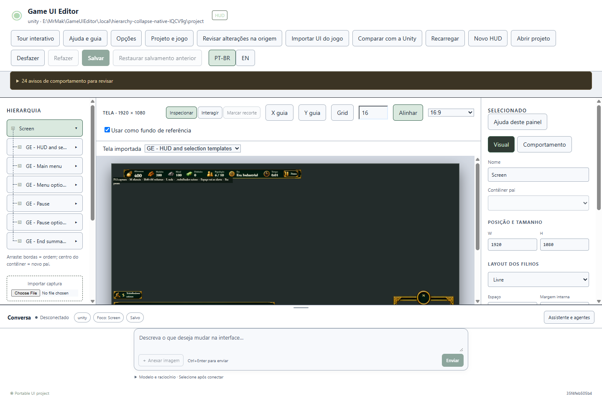
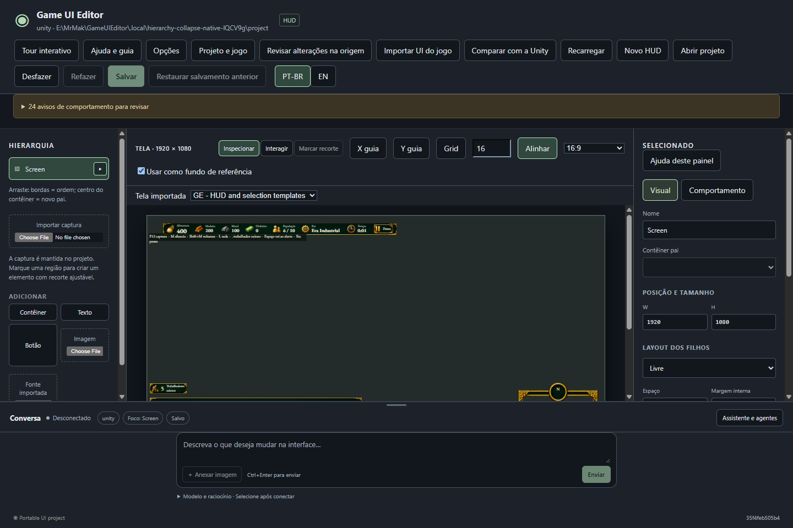

# Hierarquia recolhível — 0.3.2

**Implementado e verificado; disponível para reteste na cópia portátil.** Cada item com filhos tem uma seta à direita para recolher ou expandir seu ramo. Isso também vale para a raiz da tela.

| Ação | Resultado |
| --- | --- |
| Clicar na seta do item | Recolhe/expande seus filhos. Ramos aninhados mantêm seus estados ao reabrir o pai. |
| Usar Esquerda/Direita na linha ou Enter/Espaço na seta | Recolhe/expande pelo teclado. Os controles têm rótulos em PT-BR/EN. |

Recolher preserva a seleção e não altera a HUD, a ordem, o histórico de desfazer ou o arquivo salvo. Ao selecionar ou editar um descendente, criar um filho ou arrastar um elemento para um pai recolhido, os ancestrais necessários se abrem. O estado dos ramos vale para a sessão aberta; itens sem filhos não precisam de seta.

Use o mesmo `Open-Test.cmd` em `E:\MrMak\GameUIEditor\.local\manual-test-0.3.0-MndmD0`. Ele agora aponta para `application-0.3.2`, com os mesmos projetos. As cópias anteriores foram preservadas.

Verificação: **16 execuções focadas de interface**, oito no navegador e oito no Windows. Cobrem ramos aninhados, teclado, PT-BR/EN, temas, três larguras, seleção, arraste para pai recolhido, criação de filhos, conectores, edição de texto e importação/reimportação. A amostra real do GE passou de **430 → 7 → 1 linhas**, mantendo o projeto idêntico byte a byte.

Instalador e quatro ZIPs da 0.3.2 preparados; **264 arquivos**, hashes dos pacotes e correspondência das fontes conferidos. A instalação 0.2.0 permanece preservada. A mudança pertence à lista do editor; não exige migração, reimportação ou alteração no jogo. Aceite humano e M4/M6 continuam abertos.

[Evidências da entrega](evidence-hierarchy-0.3.2.json) · [Roteiro de teste](test-0.3.0.md) · [Ajustes anteriores — 0.3.1](fixes-0.3.1.md).
