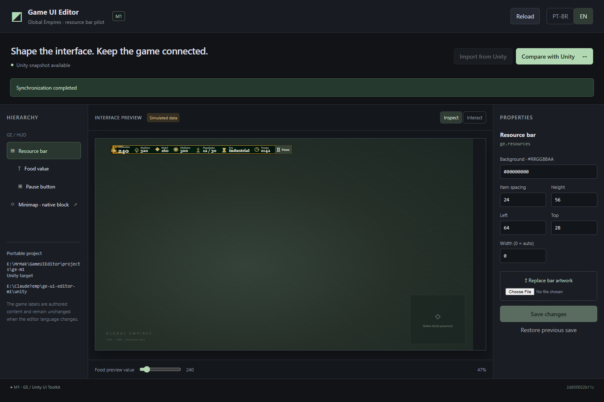
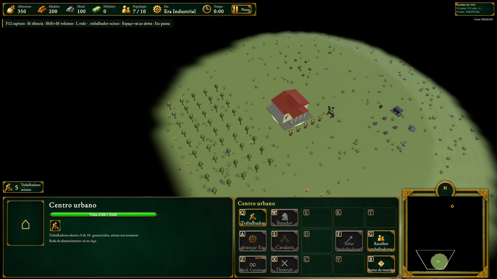
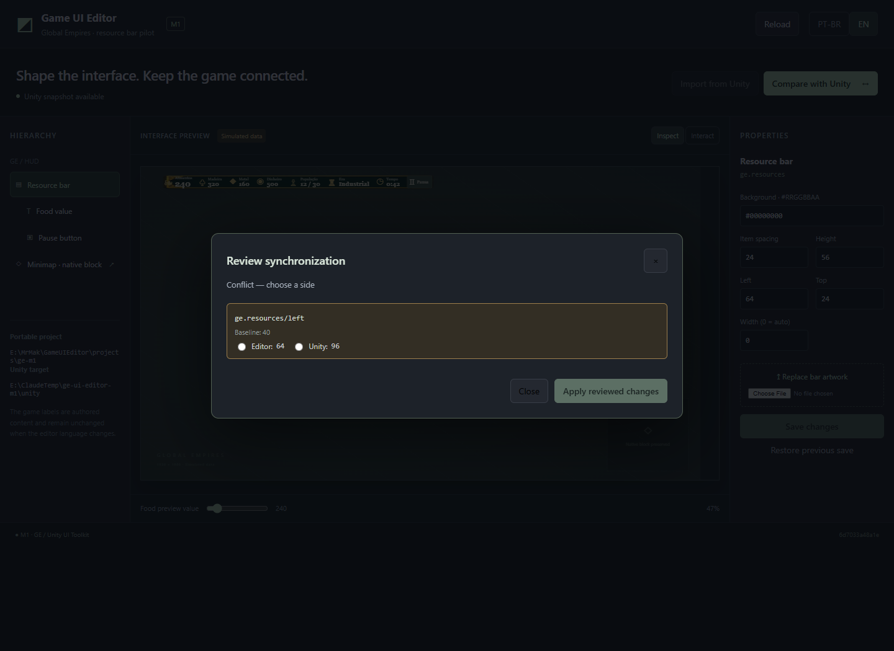
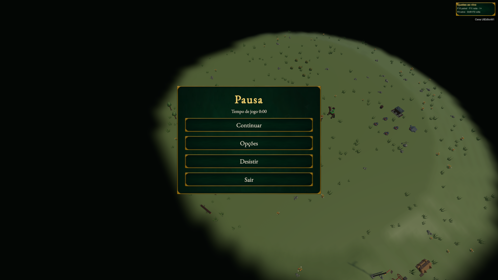

# M1: implementation and local validation

**M1 completed as a local delivery — October 18, 2026.** The Windows application
and GE integration are implemented and passed local automated/native validation.
The user approved closing M1 locally and deferring formal PR/review until the GE
baseline is published; it currently includes 146 commits not yet on GitHub.

## Open and use

Run `E:\MrMak\GameUIEditor\Open-GameUIEditor.cmd`.

```powershell
& 'E:\MrMak\GameUIEditor\Open-GameUIEditor.cmd'
```

The executable is `E:\MrMak\GameUIEditor\src-tauri\target\release\game-ui-editor.exe`.
Keep its adjacent `runtime` directory. The editable portable project is
`E:\MrMak\GameUIEditor\projects\ge-m1`; source and usage instructions are in
`E:\MrMak\GameUIEditor\README.md`.

The integration is isolated at `E:\ClaudeTemp\ge-ui-editor-m1`, branch
`codex/ui-editor-m1`, based on `aa7b912`, with Unity 6000.6.5f1. Its Unity project
contains the local `UIEditorM1` validation scene. The primary GE checkout and
unrelated Mak changes were preserved.

## Delivered M1 behavior

- PT-BR/English Windows interface with hierarchy selection, property editing,
  a PNG artwork slot and a clearly labeled simulated preview.
- Initial import from the real GE HUD tree, retaining semantic IDs, the original
  resource-bar artwork, the live food binding and the existing pause callback.
- Manual comparison/application, reverse synchronization, explicit per-property
  conflict choices and rejection of stale revisions or the wrong Unity target.
- Persistent Unity authoring asset and isolated Undo groups. Changes survive
  leaving Play Mode and reopening the scene.
- Content-addressed local artwork, recoverable local saves and a durable approved
  synchronization journal. The project owner uses a native OS-released SQLite
  lease in `.local/` to prevent concurrent writers, including after a crash.
  The authored project remains JSON.
- Claude-readable project, hierarchy, property/binding IDs and generated binding
  intent/source documentation. MCP editing remains M4.
- Existing native UI and the minimap remain in their original game code. Their
  full authoring coverage remains M2–M5, as planned.

## Validation results

- **17/17 core tests:** schema/binding validation, independent changes, explicit
  conflicts, stale revisions, target changes, atomic saves, rollback/reopen,
  idempotent recovery, opaque metadata, asset integrity, authentication, competing
  owners and a real killed writer process whose OS lease is then reacquired.
- **670/670 GE presentation tests:** no failures/skips, including eight new
  native document-contract regression tests.
- **11 browser + real Unity checks:** imported native tree/art, actual layout
  changes, real PNG replacement, typography, reverse edits, conflict review,
  stale comparison rejection, interactive simulation and bilingual UI.
- **5 native gameplay/persistence checks:** Undo preserves earlier synchronized
  properties; scene/Play reopen retains the authored document; an existing queued
  Train command changes stock and the real HUD follows it; synthetic press/release
  on the real pause button pauses MatchFlow without clearing selection/clicking
  through; controlled before/after captures preserve scene/camera/frozen state.
- **Real filesystem failure/recovery:** Windows `FileShare.Read` blocks the
  desktop commit after the actual Unity acknowledgement. The old local state is
  preserved; reopening completes the durable transaction and common baseline.
- **Native refusal checks:** a read-only Unity asset rejects writes without
  losing the local draft; other-target requests/rebinding are refused; native
  parsing retains Unicode/timestamp text and rejects six invalid document cases.
- **Actual Windows application:** packaged Tauri/WebView2 controls saved and
  synchronized an edit; closing released the host; relaunch restored the project.
  Browser checks also verified retained invalid drafts, explicit discard, modal
  background isolation and Escape handling.

Input devices/settings used by the native test were restored. No human-only test
was needed for these checks. These are functional and native rendering proofs;
final user aesthetic acceptance is separate.

## Reviewable captures

Actual packaged Windows application; preview data are simulated:



Controlled native GE baseline, with the actual scene/camera/game state frozen:



Same native scenario after authored position and typography changes:


Explicit conflict review in the authoring tool:



Actual GE pause screen reached through synthetic native mouse input:



## Source and evidence

The [machine-readable evidence record](evidence.json) lists the source locations,
base revision, test summaries and SHA-256 fingerprints of the executable and core
integration files. Detailed runtime test receipts and original captures remain
under the application's private `.local/evidence` folder.

The [full implementation plan](implementation.md) and [confirmed decisions](design.md)
retain the complete first-version scope. M2 implementation has begun; M3–M6
remain future work.

## Formal delivery gate

The GE `AGENTS.md` requires a task branch/PR and a Claude high review on that PR.
The local GE baseline is **146 commits ahead of the fetched `origin/main`**.
Publishing this branch would also publish that unrelated baseline history.

Application/integration code is local and uncommitted. No push, PR or merge was
performed. The user approved closing M1 as a local delivery and deferring formal
PR/review until the baseline is published. This closes the local M1 delivery;
it does not claim formal review or publication.
