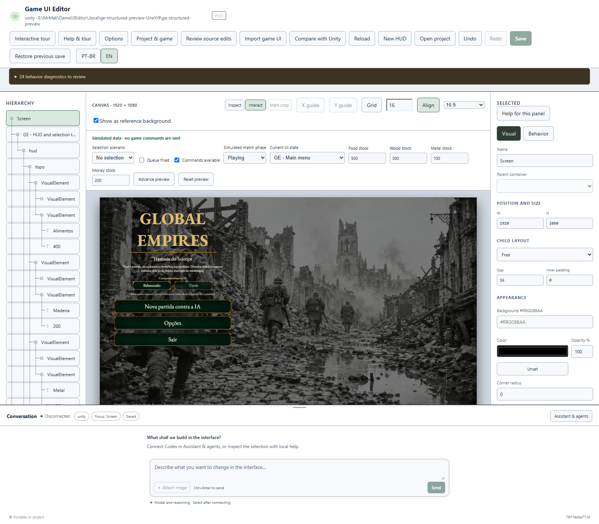
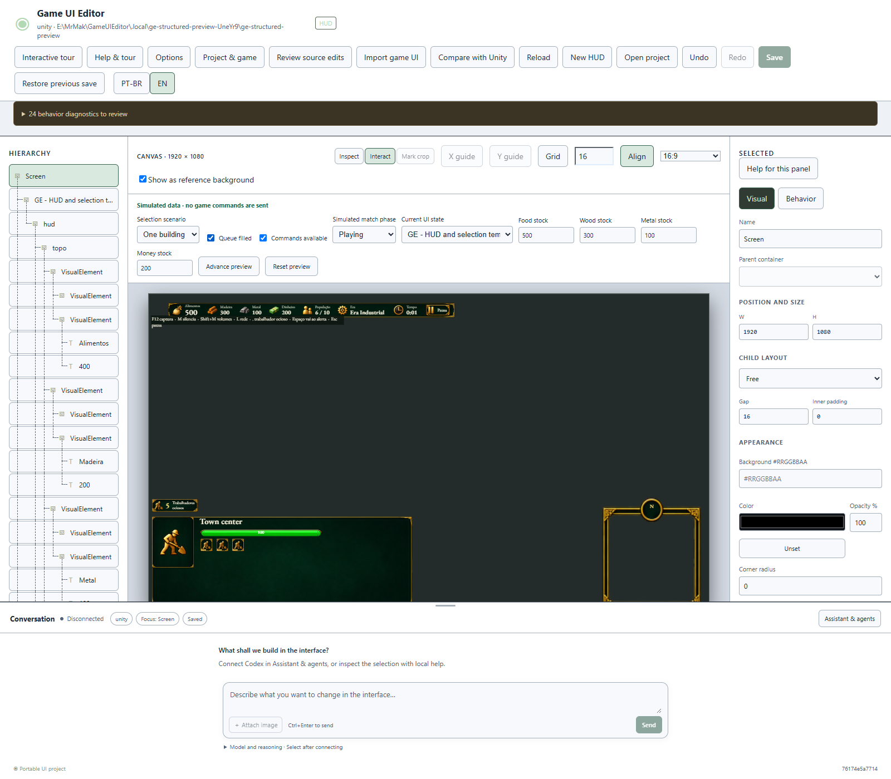

# Importação estrutural — 0.3.0

Primeira versão implementada e empacotada. A ferramenta importa controles e artes reais da Unity, sem usar uma captura recortada como base. A cobertura do GE ainda é parcial; isso aparece no inventário e nos pontos abaixo.

## O que foi feito

| Parte | Resultado |
| --- | --- |
| Exportação Unity | Árvores UI Toolkit, UXML, Canvas uGUI e prefabs. Inventário de telas, cobertura por elemento e diagnósticos de fontes não exercitadas. |
| Piloto GE | Seis telas, **430 nós normalizados e 22 recursos originais**: HUD, menu, opções, pausa, opções da pausa e resumo. Filhos editáveis e fontes/imagens mantidas no projeto portátil. |
| Simulação | Recursos vinculados ao catálogo existente, cartões de unidade/grupo/construção, templates de seleção/fila e navegação conhecida. Clique no canvas reduziu a fila simulada de três para dois. Nenhum comando real foi enviado pela prévia. |
| Aparência | Alinhamento, quebra, opacidade herdada, bordas, peso/itálico, clipping, nine-slice e visibilidade dos controles ocultos da origem. Seleção de tela também em Inspecionar. |
| Reimportação | Identidades de origem, base anterior e comparação com as edições locais. Conflitos e remoções revisados, versões obsoletas recusadas, assets conferidos por hash e gravações pelo owner. Restauração anterior à primeira importação limpa a associação. |
| Escrita na origem | Revisão de texto/tamanho/cor de fonte e fundo declarativo em UXML com chave persistente; texto/tamanho/cor em Text/TMP uGUI. A Unity confirma origem e valores, preserva callbacks e guarda backups. Layout, novos objetos e código procedural ficam fora desse writer. |
| Entrega | Instalador Windows 0.3.0 e quatro ZIPs: portátil, fontes, integração Unity com o novo pacote e piloto GE. A instalação 0.2.0 em uso foi preservada. |

## O que foi verificado

- **123 testes core**, **78 execuções de interface** (39 navegador + 39 Windows isolado) e **43 comparações TS/C#** (20 comportamento + 23 validação visual).
- **20 fixtures Unity** e verificações do contexto/comandos reais do GE passaram novamente na worktree isolada. Essa prova do adaptador existente não significa aplicação nativa completa da HUD recém-importada.
- Projeto Unity independente, sem classes/pacotes GE: UI Toolkit, Canvas, prefab, arte original intacta e identidade mantida após reordenar irmãos. Controles inativos continuam ocultos.
- Três propriedades alteradas em UXML/uGUI, cena reaberta, callbacks preservados, revisão antiga recusada e reimportação sem conflito mantendo um elemento local adicional.
- **260 arquivos** dos quatro pacotes e hashes dos ZIPs/instalador conferidos. As fontes empacotadas correspondem às fontes verificadas. O ciclo completo de instalar/atualizar/desinstalar não foi repetido nesta versão; a execução do app Windows isolado foi.
- A prova mediu **62 ms** para importar/revisar/salvar a fixture e **49 ms** para preparar a captura do GE já exportada. Esses tempos excluem inicialização e exportação da Unity; não prometem setup universal instantâneo.

## Pontos de atenção

1. **A cobertura do GE é parcial.** A grade de comandos ainda é uma observação da geometria/arte, e o minimapa importa a moldura; o renderizador continua no jogo. Ações desconhecidas exigem mapeamento.
2. UI procedural do GE não ganha escrita arbitrária em C# por esse fluxo. O bridge nativo existente continua separado e recusa vínculos pendentes. Flex responsivo, scroll/máscaras, tint/material, vetores, rich text e enquadramento cover/contain têm limitações declaradas.
3. A generalização foi comprovada em uma **fixture Unity independente**, não em um segundo jogo completo. Telas condicionais não exercitadas continuam listadas como tal. Unreal/Godot e os sete temas adicionais permanecem para depois.
4. A instalação/conexão do plugin e a primeira exportação ainda são necessárias. O aceite visual humano e o encerramento de M4/M6 continuam pendentes; os marcos históricos permanecem em 4/6.

## Como experimentar

Pacote: E:/MrMak/GameUIEditor/.local/releases/game-ui-editor-0.3.0-20261020T161005573Z.

Instalador: Game UI Editor_0.3.0_x64-setup.exe. Para importar, instale o pacote unity-import/package.json do ZIP de integração na Unity, execute **Tools → Game UI Editor → Export Existing UI**, vincule a raiz Unity e escolha **Importar UI do jogo**. Salve após revisar. Para propriedades suportadas, use **Revisar alterações na origem** e depois **Review Source Edits** na Unity, fora de Play.

[Registro de evidências e hashes](evidence-structured-import.json) · [Proposta e escopo aprovados](structured-import-proposal.md).
