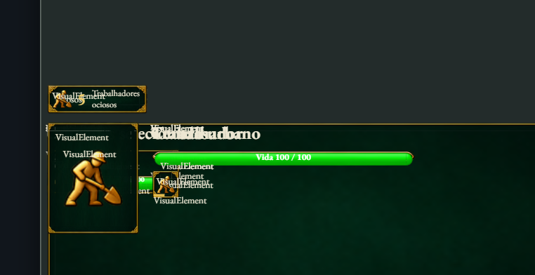

# Teste da importação — 0.3.3

**Reteste da 0.3.3 aprovado pelo usuário:** “testado e funcionando”. A confirmação é geral para os ajustes entregues; sem resultados individuais por passo. [Canvas inteiro e chat no rodapé](canvas-0.3.3.md). [Hierarquia recolhível: instruções e capturas](hierarchy-0.3.2.md). Os mesmos projetos permanecem disponíveis. [Ajustes, capturas e provas](fixes-0.3.1.md). Novos relatos serão registrados antes de implementar outras mudanças.

**Painel de comandos corrigido:** exportador 0.1.1 e amostra reimportada, com textos, artes e 15 posições. O editor agora está na 0.3.3 e o lançador é o mesmo. [Resultado e capturas](commands-0.1.1.md).

## Abrir e escolher o projeto

Pasta do teste: `E:\MrMak\GameUIEditor\.local\manual-test-0.3.0-MndmD0`.

O nome da pasta registra a preparação inicial. Os lançadores agora abrem `application-0.3.3`; a versão portátil anterior está preservada.

- Execute `Open-Test.cmd` para abrir a HUD já importada.
- Para começar pela importação, feche essa janela e execute `Open-Import.cmd`. Também é possível usar **Abrir projeto / Open project** na janela existente para alternar entre os dois projetos.
- A pasta **ge-importada** contém as seis telas e artes do GE; o nome herdado da exportação aparece como **unity**. A pasta **importar-do-zero**, chamada **Import existing UI test**, começa vazia e já vinculada à cópia da exportação.
- Os projetos ficam em `projects\ge-importada` e `projects\importar-do-zero`, dentro da pasta do teste. Edite e salve essas cópias normalmente.

## Roteiro

| Passo | Ação | Resultado esperado |
| --- | --- | --- |
| 1 — Importar | No projeto vazio, abra **Importar UI do jogo / Import game UI**, mantenha as seis telas selecionadas, revise e escolha **Salvar importação revisada / Save reviewed UI import**. | As telas aparecem como estados; a importação salva o projeto. O inventário mostra a cobertura e as limitações. |
| 2 — Conferir telas | Em **Inspecionar / Inspect**, alterne **Tela importada / Imported screen** entre HUD, menu, opções, pausa, opções da pausa e resumo. | Textos e artes aparecem; os filhos podem ser selecionados na hierarquia. Confira cortes, sobreposições, escala e legibilidade. |
| 3 — Personalizar | Selecione um texto ou botão no menu pela hierarquia. Altere texto, cor ou posição no inspetor e use **Salvar / Save**. | A edição afeta o elemento selecionado. Desfazer/refazer permite revisar o ajuste. |
| 4 — Simular | Use **Interagir / Interact**. Escolha o estado da HUD, o cenário de construção e a fila preenchida; clique em um item da fila. | A fila simulada passa de três para dois itens. Confira também os cenários de unidade/grupo e a navegação conhecida dos menus. |
| 5 — Reabrir | Salve, feche a janela e abra novamente o mesmo projeto pelo lançador correspondente. | A personalização e as artes continuam presentes. O estado momentâneo da simulação pode reiniciar. |
| 6 — Reimportar | Com a edição salva, abra novamente a importação, revise a mesma origem e salve a revisão. | A personalização local permanece; não aparecem elementos duplicados. Se houver um conflito, revise as escolhas antes de salvar. |

## Limites desta sessão

A origem é uma **cópia da exportação real anterior do GE**, com manifesto e recursos intactos. A pasta `export-snapshot` não é um projeto Unity executável. A sessão permite avaliar o editor, a importação, a simulação, o salvamento e a reimportação sem abrir a Unity.

A grade de comandos é uma amostra visual estática; quando a origem estava oculta, usa um exemplo declarado de trabalhador. O exportador 0.1.1 corrige as medidas zeradas da captura anterior. Mudanças completas por seleção, custos e disponibilidade não fazem parte desta entrega. O minimapa preserva a moldura, e seu renderizador permanece no jogo. O resumo representa a condição capturada.

Aplicar alterações no jogo, escrever propriedades nos assets Unity, validar o instalador e avaliar o primeiro login real ficam para testes separados. A sessão preparada não requer conectar o assistente nem enviar mensagens a modelos. O aceite M4/M6 permanece aberto.

## Como relatar

Informe **passo/tela → ação → o que aconteceu → o que esperava**. Exemplo: “Passo 2, opções da pausa: o texto fica cortado quando amplio o painel”. Pode enviar os relatos aqui durante o teste; serão apenas registrados.

## Feedback registrado — reteste aprovado

Os dois primeiros achados foram corrigidos na 0.3.1; o painel de comandos foi
corrigido no exportador 0.1.1 e na amostra reimportada. A 0.3.3 ajusta o canvas e o rodapé do chat. O usuário aprovou o reteste geral, sem detalhar cada achado:

| ID | Gravidade | Relato |
| --- | --- | --- |
| PT-2026-10-20-01 | Média | O chat ocupa espaço excessivo mesmo com a altura reduzida ao mínimo pelo divisor arrastável. Relato do usuário; sem reprodução adicional nesta rodada. |
| PT-2026-10-20-02 | Alta | Nomes como “VisualElement” aparecem sobre os textos e artes da HUD, tornando quase impossível distinguir o conteúdo do jogo dos nomes internos. A sobreposição está visível na captura enviada. |
| PT-2026-10-20-03 | Alta | Painel de comandos ausente por captura com medidas zeradas. Corrigido no exportador 0.1.1 e na amostra reimportada; incluído no reteste geral aprovado. |
| PT-2026-10-20-04 | Alta | Canvas exige scroll até a parte inferior. Corrigido na 0.3.3 com enquadramento por largura/altura e chat no rodapé; reteste geral aprovado. |

Registro detalhado: `E:\MrMak\GameUIEditor\docs\playtests\2026-10-20-0.3.0.md`. Sem issues externas: o repositório do aplicativo não tem remote configurado. As correções foram autorizadas depois do registro inicial; [resultado na 0.3.1](fixes-0.3.1.md).

## Conferência da preparação inicial — 0.3.0

Os hashes do instalador e dos quatro ZIPs conferem com o pacote 0.3.0; os 260 arquivos dos manifests também foram conferidos. Uma cópia temporária da aplicação Windows importou seis telas pela interface, manteve 430 nós e 22 recursos ao recarregar e simulou a fila de três para dois, sem erros de página. Os dois projetos destinados ao seu teste permaneceram no estado inicial.

Esta é uma verificação focada da preparação, separada da suíte histórica e do aceite visual humano. [Evidência desta preparação](evidence-test-preparation-0.3.0.json) · [Entrega e limites da 0.3.0](structured-import-0.3.0.md).
